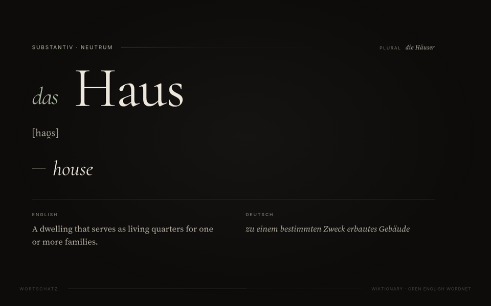
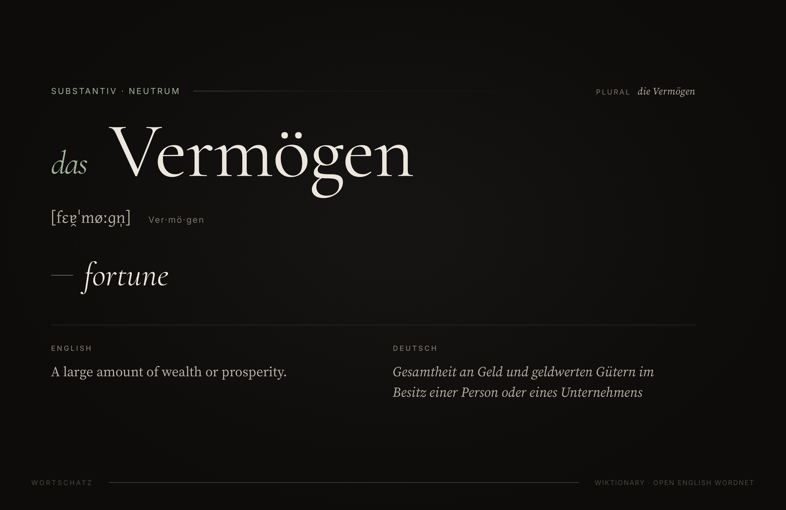
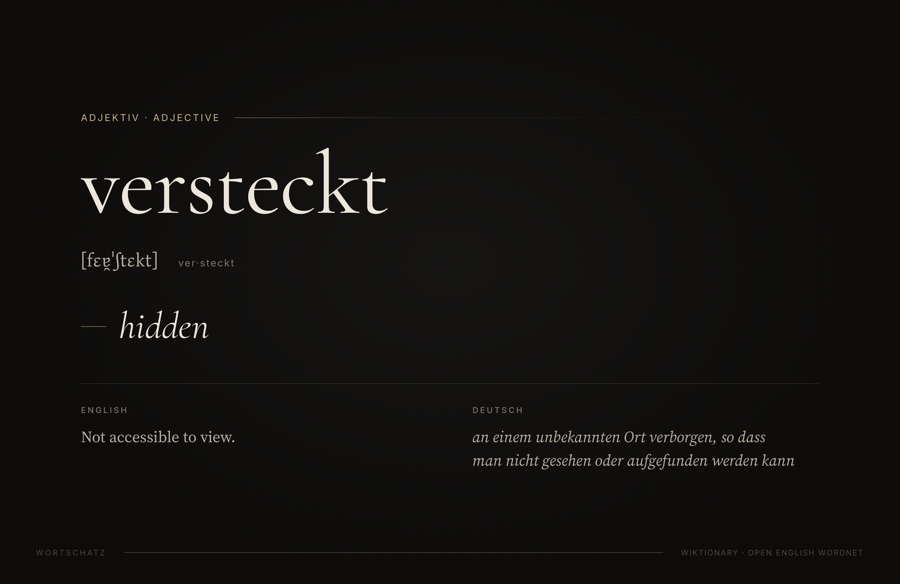

<h1 align="center">Wortschatz</h1>

<p align="center">
  <em>A quiet, typographic screen saver for learning German vocabulary.</em><br>
  One word at a time: article, pronunciation, meaning, and definitions in English <strong>and</strong> German.
</p>

<p align="center">
  
</p>
<p align="center"><sub>The real renderer, captured frame by frame (sped up: on screen each card stays for about 30 seconds).
<a href="docs/images/wortschatz.mp4">Higher-quality MP4</a></sub></p>

---

macOS ships a screen saver that shows dictionary words, but its definitions are German-only.
That is lovely if you already speak German and not much help if you are still learning it.
**Wortschatz** ("vocabulary") shows each word together with everything a learner needs to remember it.

<p align="center">
  
</p>

## Features

- **1,113 common words.** Nouns, verbs, adjectives and adverbs, chosen by frequency from real
  spoken German (film subtitles), so you meet the words you will actually hear.
- **Everything on one card.** Each card shows the article, IPA, syllables, the English equivalent,
  an English definition, a German definition, and key forms.
- **Gender at a glance.** *der*, *die* and *das* each get their own muted colour (blue, rose, sage),
  so gender sinks in without flashcard drilling.
- **Real data, nothing invented.** Everything comes from Wiktionary and Open English WordNet.
  There is no machine translation, and mismatched senses were reviewed by hand and dropped.
- **Calm by design.** Each card holds for about 32 seconds and cross-fades slowly with a gentle drift.
  The design is dark and editorial, with open-licensed type.
- **Fair shuffle.** Every word appears once before any repeats, and none of the last 8 comes back
  soon. Progress is remembered between sessions.
- **Offline and silent.** Fonts and data are bundled. There are no network requests, no telemetry
  and no sound.
- **Portable core.** A Rust engine plus an HTML/CSS renderer, wrapped by a thin native shell.
  macOS is done; Linux (Omarchy/Hyprland) is planned.

## What a card shows

<table>
  <tr>
    <td width="50%"></td>
    <td width="50%"></td>
  </tr>
  <tr>
    <td align="center"><sub>Noun: article in the gender colour, plural, IPA, syllables</sub></td>
    <td align="center"><sub>Adjective: part of speech in German and English</sub></td>
  </tr>
</table>

| | |
|---|---|
| **Word** | with *der / die / das* for nouns |
| **Pronunciation** | IPA (rendered in Gentium Plus) and syllable breaks |
| **English** | the English equivalent(s) for that sense |
| **Definitions** | English (Open English WordNet) beside German (Wiktionary) |
| **Forms** | noun plural · verb *er/sie/es* form, simple past, participle with *haben/sein* · comparative and superlative |

The preview in System Settings uses a compact layout that shows a real card, not a blank tile:

<p align="center"></p>

## Try it in a browser

No build needed. Open **`core/index.html`** in any browser; it works straight from disk, offline.

| Add to the URL | Effect |
|---|---|
| `?hold=8&fade=1200` | faster cycling (hold in seconds, fade in ms) |
| `?id=Haus%23noun&still` | pin one card and stop the timer |
| `?preview` | the compact thumbnail layout |

Press **→** or **space** to skip to the next card.

## Install on macOS

**Requirements:** macOS 13 or later on Apple silicon, plus:

- the Xcode Command Line Tools (`xcode-select --install`), which provide `swiftc` and `codesign`;
- [Rust](https://rustup.rs).

The full Xcode app is not needed.

```sh
cd wortschatz
scripts/install-macos.sh            # build, ad-hoc sign, copy to ~/Library/Screen Savers
scripts/install-macos.sh --select   # same, then open System Settings > Screen Saver
```

Then go to **System Settings → Screen Saver**, scroll to **Other** and pick **Wortschatz**.
macOS 14+ stores this choice in an opaque per-display wallpaper store, so the scripts open the
pane for you rather than editing it.

Notes:

- Build output goes to `~/Library/Caches/wortschatz-build`, outside the source tree.
  Override it with `WZ_BUILD_DIR=…`.
- Building only, without installing: `scripts/build-macos.sh`.
- Intel Macs: run `rustup target add x86_64-apple-darwin` first; the build script then produces
  a universal binary.
- After reinstalling, macOS may keep the old build loaded. The install script restarts
  `legacyScreenSaver`; if the old build still appears, log out and back in.

**Uninstall**

```sh
rm -rf ~/Library/Screen\ Savers/Wortschatz.saver ~/Library/Application\ Support/Wortschatz
```

The second folder only holds the shuffle position.

### Gatekeeper

The bundle is **ad-hoc signed** (`codesign --sign -`), not notarized. A copy you build yourself
loads normally. If you copy a built `.saver` to another Mac (AirDrop, a download), macOS may block
it. Then either run

```sh
xattr -dr com.apple.quarantine ~/Library/Screen\ Savers/Wortschatz.saver
```

or allow it under **System Settings → Privacy & Security → Open Anyway**.

## How it works

```
core/        renderer: index.html + style.css + app.js, bundled fonts, data/lexicon.{json,js}
engine/      Rust crate wortschatz-core: lexicon, fair shuffle with saved progress, card formatting
             C ABI (wortschatz.h) + CLI: wortschatz validate | next | stats
macos/       Swift ScreenSaverView hosting core/ in a WKWebView, driven by the Rust engine
linux/       Omarchy / Hyprland plan + stub
data-build/  reproducible lexicon build (Wiktionary + Open English WordNet + frequency list)
scripts/     build-macos.sh, install-macos.sh, select-macos.sh
tools/       snapshot.swift (renders the built .saver to PNG), README media capture
```

```
 ┌────────────── Rust engine ──────────────┐      ┌──────── core/ (HTML/CSS/JS) ────────┐
 │ lexicon · shuffle deck · card formatting│ JSON │ typography, layout, fades           │
 └───────────────────┬─────────────────────┘ ───▶ └─────────────────────────────────────┘
                     │ C ABI                                 ▲
             ┌───────┴────────┐                              │ WKWebView
             │ Swift .saver   │──────────────────────────────┘
             └────────────────┘
```

- **Engine.** The Rust engine decides what comes next and formats the card. The page only renders it.
- **macOS shell.** The Swift `ScreenSaverView` calls the engine through the C ABI and pushes each
  card into the page (`Wortschatz.show(card)`).
  - Pacing runs on `animateOneFrame`, so `stopAnimation` really pauses.
  - The saver exits cleanly when the screen saver stops.
- **Standalone mode.** In a plain browser, `app.js` uses a small JavaScript mirror of the same deck logic.
- **Hidden pages.** WebKit freezes CSS transitions in pages it considers hidden, such as an off-screen
  thumbnail. In that case cards appear without the fade instead of staying invisible.

Engine checks:

```sh
cd engine
cargo test
cargo run --release --bin wortschatz -- validate ../core/data/lexicon.json   # 1113 entries, 0 problems
```

## Linux (Omarchy / Hyprland)

The port is **documented but not built yet**. [`linux/README.md`](linux/README.md) describes the plan:

- a small Rust `tao` + `wry` (WebKitGTK) runner that reuses `engine/` and `core/` unchanged;
- shown fullscreen, or as a layer-shell overlay, on every output;
- started by `hypridle` and closed on input.

`linux/wortschatz-preview.sh` is a kiosk-browser stopgap in the meantime.

## The word list

Building the lexicon is reproducible; see [`data-build/README.md`](data-build/README.md).

1. **Candidates.** The most frequent words in German subtitles become candidates.
2. **German side.** For each candidate, the German Wiktionary entry supplies article, IPA, forms,
   the German definition, and the English translations *for that specific sense*.
3. **Cross-check.** Those translations are checked against English Wiktionary.
4. **English definition.** The English definition comes from Open English WordNet, matched by sense.
5. **Review.** Every remaining pairing where the English and German senses disagreed was reviewed
   by hand. 187 were dropped and are listed in `data-build/exclude.tsv`.

No CEFR levels are shown, because none of the sources provides them and they are not guessed.

## Data sources and licences

| | Source | Licence |
|---|---|---|
| German entries, IPA, forms, German definitions, English translations | [German Wiktionary](https://de.wiktionary.org) via [kaikki.org / wiktextract](https://kaikki.org) | CC BY-SA 4.0 / GFDL |
| Cross-check and sense alignment | [English Wiktionary](https://en.wiktionary.org) via kaikki.org | CC BY-SA 4.0 / GFDL |
| English definitions | [Open English WordNet 2024](https://en-word.net) | CC BY 4.0 |
| Word frequency | [hermitdave/FrequencyWords](https://github.com/hermitdave/FrequencyWords) | CC BY-SA 4.0 |
| Fonts | Cormorant Garamond, Source Serif 4, Inter, Gentium Plus | SIL OFL 1.1 |

- **Code:** [MIT](LICENSE).
- **Compiled word list** (`core/data/`): **CC BY-SA 4.0**. Each entry links back to its sources.
- **Fonts:** licence texts are in `core/fonts/`.

Full details are in [DATA_SOURCES.md](DATA_SOURCES.md).

---

<p align="center"><sub>Viel Spaß beim Lernen.</sub></p>
