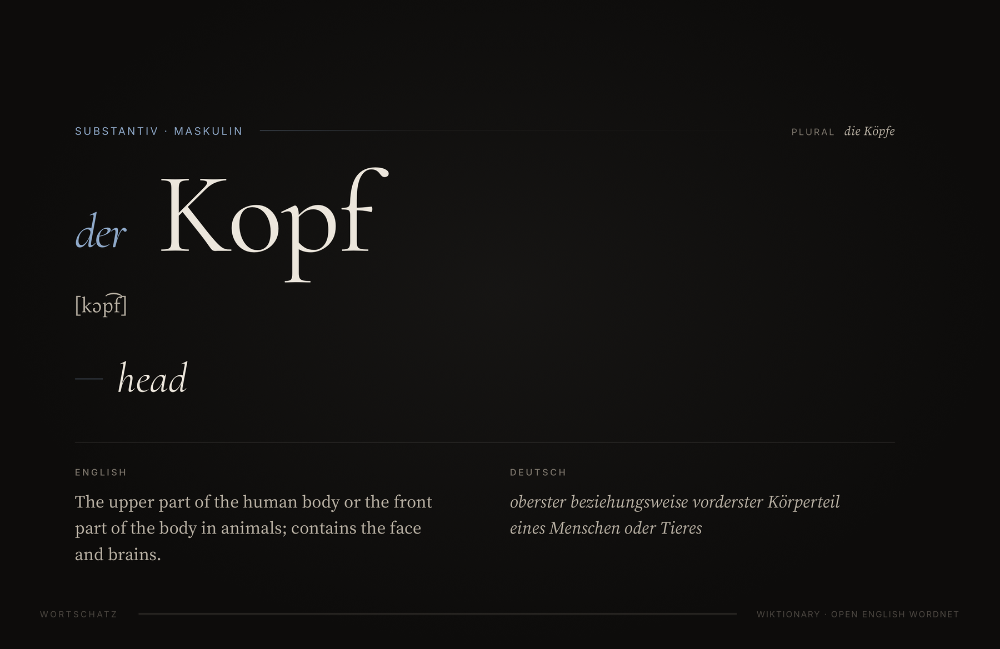
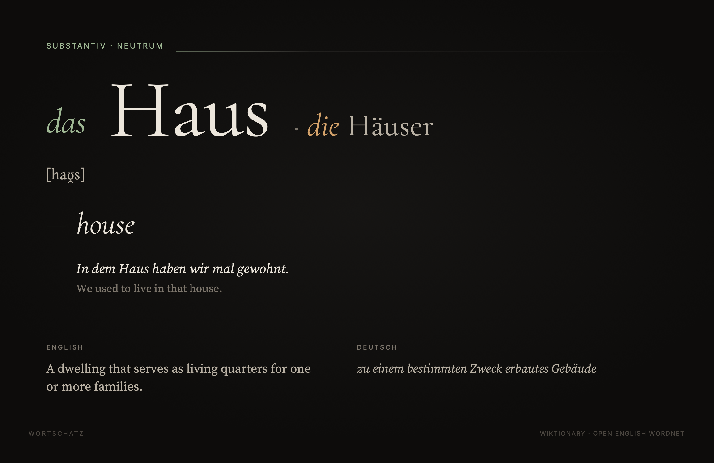
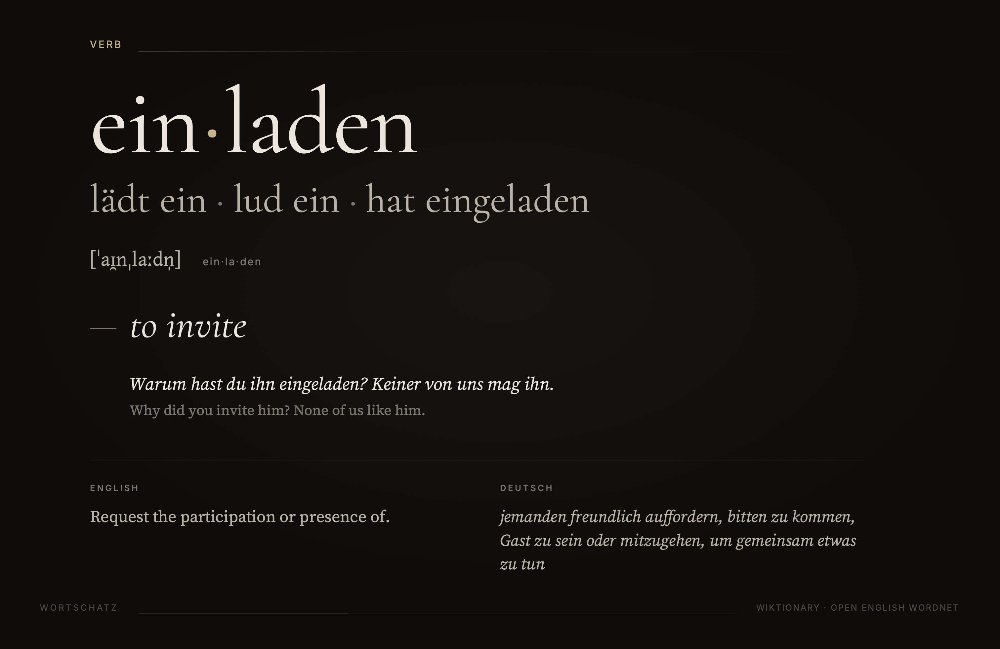
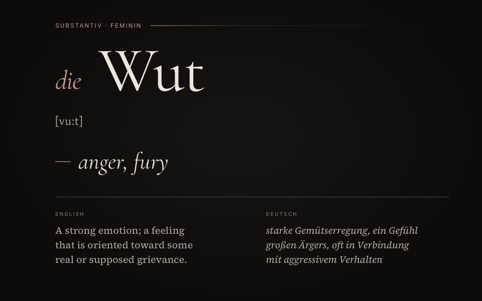

<h1 align="center">Wortschatz</h1>

<p align="center">
  <em>A quiet, typographic screen saver for learning German vocabulary.</em><br>
  One word at a time: article and plural, verb forms, pronunciation, meaning, an example sentence,<br>
  and definitions in English <strong>and</strong> German.
</p>

<p align="center">
  
</p>
<p align="center"><sub>The real renderer, captured frame by frame (sped up: on screen each card stays for about 30 seconds).
<a href="docs/images/wortschatz.mp4">Higher-quality MP4</a></sub></p>

---

macOS ships a screen saver that shows dictionary words, but its definitions are German-only.
That is lovely if you already speak German and not much help if you are still learning it.
**Wortschatz** ("vocabulary") shows each word together with everything a learner needs to remember it.

<p align="center">
  
</p>

## Features

- **1,114 common words.** Nouns, verbs, adjectives and adverbs, chosen by frequency from real
  spoken German (film subtitles), so you meet the words you will actually hear.
- **Everything on one card.** Each card shows the article, IPA, syllables, the English equivalent,
  an English definition, a German definition, and the grammar you need to use the word.
- **Gender at a glance.** *der*, *die* and *das* each get their own muted colour (blue, rose, sage),
  so gender sinks in without flashcard drilling. The plural *die* has its own ochre, so it never
  reads as feminine.
- **Plurals.** Nouns show singular and plural side by side (*das Haus · die Häuser*). Nouns
  without a plural say *kein Plural*; plural-only nouns (*die Daten*) are marked *nur Plural*.
- **Verb principal parts.** *fährt · fuhr · ist gefahren*: the present is listed only when it is
  irregular, then the simple past and the perfect with *ist* or *hat*. Separable verbs show their
  particle (*an·fangen · fängt an · fing an · hat angefangen*) and reflexive verbs their *sich*
  (*sich benehmen · benimmt sich · benahm sich · hat sich benommen*).
- **Example sentences.** Just under a third of the cards add one short German sentence (90
  characters at most) with its English translation, taken from English Wiktionary's usage
  examples for that sense. Cards without an example that clearly fits the shown meaning simply
  leave the line out.
- **Real data, nothing invented.** Everything comes from Wiktionary and Open English WordNet.
  There is no machine translation, and mismatched senses were reviewed by hand and dropped.
- **Calm by design.** Each card fades in over 2.6 seconds, holds for about 32 seconds and fades out
  over 2.08 seconds with a gentle drift. Both renderers read these numbers from `core/timing.js`.
  The design is dark and editorial, with open-licensed type.
- **Fair shuffle.** Every word appears once before any repeats, and none of the last 8 comes back
  soon. Progress is remembered between sessions.
- **Offline and silent.** Fonts and data are bundled. There are no network requests, no telemetry
  and no sound.
- **Portable core.** One Rust engine picks and formats the cards everywhere. On macOS the saver
  draws them natively with CoreText; in a browser (and on the planned Linux port) the HTML/CSS
  renderer shows the same design.

## What a card shows

<table>
  <tr>
    <td width="50%"></td>
    <td width="50%"></td>
  </tr>
  <tr>
    <td align="center"><sub>Noun: article in the gender colour, plural with its own <em>die</em>, example sentence</sub></td>
    <td align="center"><sub>Separable verb: particle marked, principal parts with the auxiliary</sub></td>
  </tr>
</table>

| | |
|---|---|
| **Word** | with *der / die / das* for nouns, *sich* for reflexive verbs, *an·fangen* for separable verbs |
| **Pronunciation** | IPA (rendered in Gentium Plus) and syllable breaks |
| **English** | the English equivalent(s) for that sense |
| **Definitions** | English (Open English WordNet) beside German (Wiktionary) |
| **Forms** | noun plural (or *kein Plural*) · verb principal parts: irregular present, simple past, perfect with *ist/hat* · comparative and superlative |
| **Example** | one short German sentence with its English translation, when Wiktionary has a good one |

The preview in System Settings uses a compact layout that shows a real card, not a blank tile:

<p align="center"></p>

## Try it in a browser

No build needed. Open **`core/index.html`** in any browser; it works straight from disk, offline.

| Add to the URL | Effect |
|---|---|
| `?hold=8&fade=1200` | faster cycling (hold in seconds, fade in ms) |
| `?id=Haus%23noun&still` | pin one card and stop the timer |
| `?preview` | the compact thumbnail layout |

Press **→** or **space** to skip to the next card.

## Install on macOS

**Requirements:** macOS 13 or later on Apple silicon, plus:

- the Xcode Command Line Tools (`xcode-select --install`), which provide `swiftc` and `codesign`;
- [Rust](https://rustup.rs).

The full Xcode app is not needed.

```sh
cd wortschatz
scripts/install-macos.sh            # build, ad-hoc sign, copy to ~/Library/Screen Savers
scripts/install-macos.sh --select   # same, then open System Settings > Screen Saver
```

Then go to **System Settings → Screen Saver**, scroll to **Other** and pick **Wortschatz**.
macOS 14+ stores this choice in an opaque per-display wallpaper store, so the scripts open the
pane for you rather than editing it.

Notes:

- Build output goes to `~/Library/Caches/wortschatz-build`, outside the source tree.
  Override it with `WZ_BUILD_DIR=…`.
- Building only, without installing: `scripts/build-macos.sh`.
- Intel Macs: run `rustup target add x86_64-apple-darwin` first; the build script then produces
  a universal binary.
- After reinstalling, macOS may keep the old build loaded. The install script restarts
  `legacyScreenSaver`; if the old build still appears, log out and back in.

**Uninstall**

```sh
rm -rf ~/Library/Screen\ Savers/Wortschatz.saver ~/Library/Application\ Support/Wortschatz
```

The second folder only holds the shuffle position.

### Gatekeeper

The bundle is **ad-hoc signed** (`codesign --sign -`), not notarized. A copy you build yourself
loads normally. If you copy a built `.saver` to another Mac (AirDrop, a download), macOS may block
it. Then either run

```sh
xattr -dr com.apple.quarantine ~/Library/Screen\ Savers/Wortschatz.saver
```

or allow it under **System Settings → Privacy & Security → Open Anyway**.

## How it works

```
core/        web renderer (index.html + style.css + app.js), timing.js, fonts, data/lexicon.{json,js}
engine/      Rust crate wortschatz-core: lexicon, fair shuffle with saved progress, card formatting
             C ABI (wortschatz.h) + CLI: wortschatz validate | next | stats | card
macos/       Swift ScreenSaverView + native CoreText card renderer, driven by the Rust engine
linux/       Omarchy / Hyprland plan + stub
data-build/  reproducible lexicon build (Wiktionary + Open English WordNet + frequency list)
scripts/     build-macos.sh, install-macos.sh, select-macos.sh
tools/       snapshot.swift (renders the built .saver to PNG), README media capture
```

```
                 ┌────────────── Rust engine ──────────────┐
                 │ lexicon · shuffle deck · card formatting│
                 └──────┬───────────────────────────┬──────┘
                  C ABI │ card JSON                 │ (Linux: as a Rust crate, planned)
          ┌─────────────┴─────────────┐   ┌─────────┴──────────────────────────┐
          │ macOS .saver (Swift)      │   │ core/ web renderer (HTML/CSS/JS)   │
          │ CoreText drawing, fades   │   │ browser preview · Linux WebView    │
          └───────────────────────────┘   └────────────────────────────────────┘
                 same fonts, palette, spacing and motion on both sides
```

- **Engine.** The Rust engine decides what comes next and formats the card. Renderers only draw it.
- **macOS saver.** The Swift `ScreenSaverView` calls the engine through the C ABI and draws each
  card with AppKit/CoreText (`macos/Sources/CardRenderer.swift`), mirroring `core/style.css`:
  same unit system, bundled fonts, colours, spacing, fades and drift.
  - Each card is laid out and rendered once into a bitmap; the fades and drift only move that
    bitmap, so the saver idles at a few percent CPU.
  - Pacing runs on `animateOneFrame` with a clock that only advances while animating, so
    `stopAnimation` really pauses. The saver exits cleanly when the screen saver stops.
  - Why not a WebView? Inside macOS's `legacyScreenSaver` host, WebKit treats the page as
    hidden: its WebContent process is throttled within half a second and suspended a few seconds
    later, so the first card showed and then the screen went blank. Native drawing has no such
    out-of-process renderer.
  - The saved deck position is checked in full (sizes, bounds, a true permutation) before it is
    used; anything inconsistent starts a fresh shuffle. The C entry points never let a Rust panic
    cross into Swift.
- **Browser.** `core/index.html` renders the same design; `app.js` uses a small JavaScript mirror of
  the deck logic.
- **Timing.** `core/timing.js` is the one timing spec for both renderers (the saver bundles it):
  fade in 2.6 s (drift 4.16 s), progress hairline 32 s, fade out 2.08 s starting at 32.39 s, next
  card at 34.6 s.

Engine checks:

```sh
cd engine
cargo test
cargo run --release --bin wortschatz -- validate ../core/data/lexicon.json   # 1114 entries, 0 problems
cargo run --release --bin wortschatz -- stats ../core/data/lexicon.json      # grammar/example coverage
cargo run --release --bin wortschatz -- card ../core/data/lexicon.json einladen   # one card's JSON
```

## Linux (Omarchy / Hyprland)

The port is **documented but not built yet**. [`linux/README.md`](linux/README.md) describes the plan:

- a small Rust `tao` + `wry` (WebKitGTK) runner that reuses `engine/` and `core/` unchanged;
- shown fullscreen, or as a layer-shell overlay, on every output;
- started by `hypridle` and closed on input.

`linux/wortschatz-preview.sh` is a kiosk-browser stopgap in the meantime.

## The word list

Building the lexicon is reproducible; see [`data-build/README.md`](data-build/README.md).

1. **Candidates.** The most frequent words in German subtitles become candidates.
2. **German side.** For each candidate, the German Wiktionary entry supplies article, IPA, forms
   (plural, present, past, participle, auxiliary), the German definition, and the English
   translations *for that specific sense*.
3. **Cross-check.** Those translations are checked against English Wiktionary.
4. **English definition.** The English definition comes from Open English WordNet, matched by sense.
5. **Grammar and examples.** English Wiktionary adds the *no plural* / *plural only* marks, confirms
   a second perfect auxiliary (*ist / hat gestanden*), and supplies the usage example for the
   card's sense. Separable particles and *sich* come from the German forms (*ruft an*, *benimmt sich*)
   and the chosen sense. A verb whose chosen sense is transitive or reflexive shows *hat*
   (*hat geheilt*, not *ist geheilt*), and an example that uses the other auxiliary is left out.
6. **Review.** Every remaining pairing where the English and German senses disagreed was reviewed
   by hand. 188 were dropped and are listed in `data-build/exclude.tsv`; five example sentences
   were dropped in `data-build/example_exclude.tsv`.

No CEFR levels are shown, because none of the sources provides them and they are not guessed.

## Data sources and licences

| | Source | Licence |
|---|---|---|
| German entries, IPA, forms, German definitions, English translations | [German Wiktionary](https://de.wiktionary.org) via [kaikki.org / wiktextract](https://kaikki.org) | CC BY-SA 4.0 / GFDL |
| Cross-check, sense alignment, number marks, usage examples | [English Wiktionary](https://en.wiktionary.org) via kaikki.org | CC BY-SA 4.0 / GFDL |
| English definitions | [Open English WordNet 2024](https://en-word.net) | CC BY 4.0 |
| Word frequency | [hermitdave/FrequencyWords](https://github.com/hermitdave/FrequencyWords) | CC BY-SA 4.0 |
| Fonts | Cormorant Garamond, Source Serif 4, Inter, Gentium Plus | SIL OFL 1.1 |

- **Code:** [MIT](LICENSE).
- **Compiled word list** (`core/data/`): **CC BY-SA 4.0**. Each entry links back to its sources.
- **Fonts:** licence texts are in `core/fonts/`.

Full details are in [DATA_SOURCES.md](DATA_SOURCES.md).

---

<p align="center"><sub>Viel Spaß beim Lernen.</sub></p>
